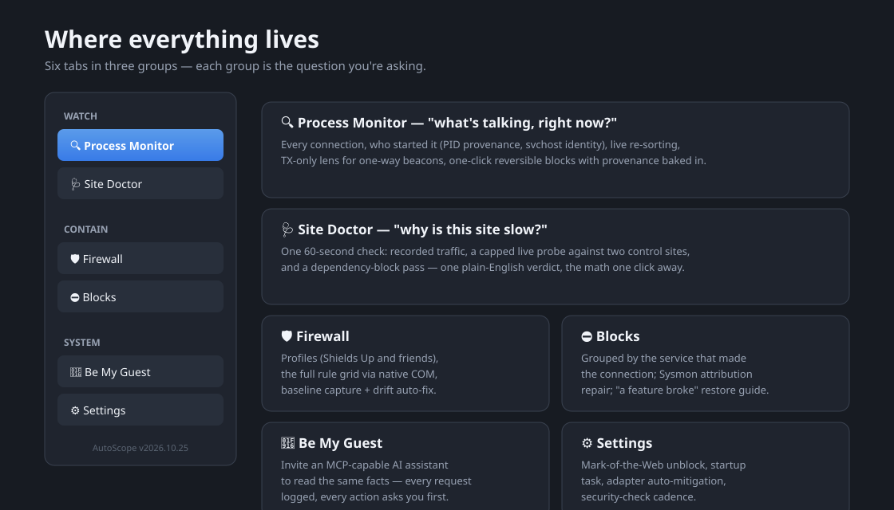
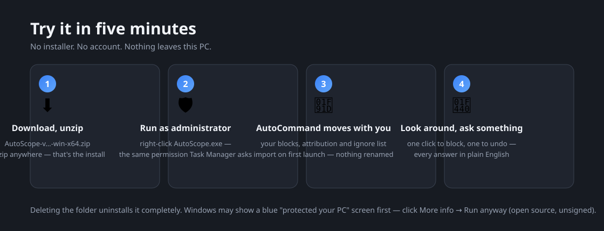
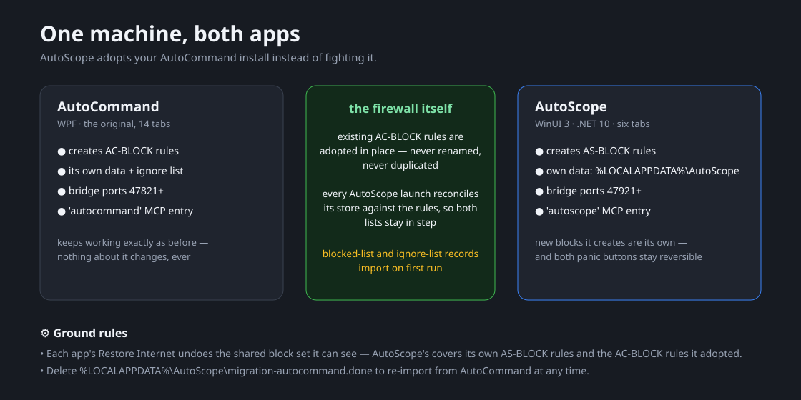
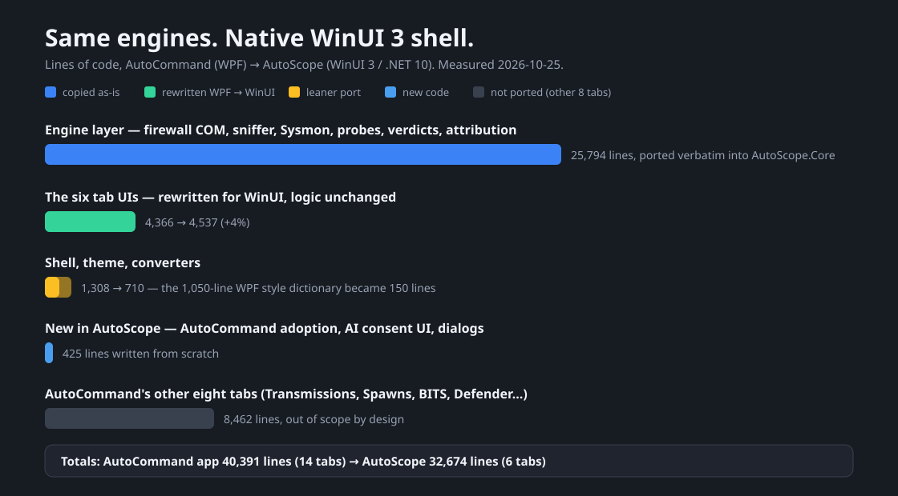

# AutoScope — see what your Windows PC is really doing



**You already know the feeling.** A program you can't name is uploading something. A site you need is suddenly slow. Your antivirus says "no threats found" and offers nothing else. You don't need another guard dog — you need to *see what's going on*.

AutoScope is that visibility, built as a **native Windows app** — WinUI 3, .NET 10, no browser in sight. It watches every connection on the machine, explains each one in plain English, and stops anything you don't want with one reversible click. It's the six essential tabs of its older sibling [**AutoCommand**](https://github.com/dparksports/autocommand-windows) with the same battle-tested engines — and if you already run AutoCommand, switching costs you nothing.

[](LICENSE)

## Try it in five minutes



That's the whole tutorial. Looking changes nothing; deleting the folder uninstalls it completely.

> **Windows may show a blue "protected your PC" screen** because the app isn't from a big company. Click **More info → Run anyway**. It's open source — anyone can read exactly what it does, and that's rather the point.

## Where everything lives


The sidebar groups its tools by the question you're asking:

- **WATCH** — *what's happening?* **Process Monitor** lists every connection live: who's talking, to whom, who started it (real PID provenance, svchost decoded to the service inside). The **TX-only** lens narrows it to one-way beacons — sends with no reply. When a site feels broken, **Site Doctor** runs one 60-second check and answers in one sentence, with the math one click away.
- **CONTAIN** — *stopping things.* The **Firewall** tab drives Windows Defender Firewall through its native COM API — profile presets, the full rule grid, baseline capture with automatic drift repair. **Blocks** shows every block this app created, grouped by the *Windows service* that actually made the connection — and when something you need breaks, its restore guide names the exact rules to lift.
- **SYSTEM** — *the rest.* **Be My Guest** lets an AI assistant (ZCode, Claude Desktop, any MCP client) read these same facts — never wander — with every request logged and every action asking you first. **Settings** covers the unglamorous essentials.

One rule everywhere: *nothing runs without you, nothing is guessed, and everything it remembers is a readable file on your own disk.*

## Already running AutoCommand?



AutoScope was built to **adopt, not replace**. On first launch it imports your blocked list (with all its attribution history) and your ignored-process list from AutoCommand, and it manages your existing `AC-BLOCK` firewall rules **in place** — nothing renamed, nothing duplicated, AutoCommand keeps working exactly as before. New blocks it creates carry its own `AS-BLOCK` prefix, its data lives in its own folder, its AI bridge uses its own ports: the two apps coexist cleanly, and every launch reconciles the lists so they stay in step.

| What's shared | What stays separate |
|---|---|
| The firewall rules themselves (adopted in place, reconciled every launch) | Block stores, ignore lists, data folders |
| Your machine's Sysmon archive feeds both | Bridge ports, MCP registration ids |

## How it was built



AutoCommand's engine layer — ~25,800 lines of firewall COM interop, raw-socket capture, Sysmon analysis, site probing and plain-English verdict logic — was **ported verbatim**: what runs here is line-for-line the code that's been shipping in AutoCommand, re-verified by AutoCommand's own offline self-test (ALL PASS). Only the shell is new: the six tab UIs rewritten for WinUI 3 within a few percent of their original size, and ~400 lines of new glue for the AutoCommand adoption, the AI consent dialogs and light-dismiss popups. AutoCommand's other eight tabs (Transmissions, Spawns, BITS, Defender, …) are intentionally out of scope.

Why native? Same reason you're reading this: no bundled browser, self-contained .NET 10 binaries, startup and idle cost you can feel — and a UI stack that will outlive any web-view fashion.

## Your privacy, in one sentence

Everything happens on your computer; the app talks to no one — not even us — and the only network traffic it ever sends is the handful of handshakes you explicitly fire from Site Doctor, every one of them itemized in its log.

## Downloads

| File | For |
|---|---|
| `AutoScope-v…-win-x64.zip` | Windows 10 and 11 — unzip anywhere, right-click `AutoScope.exe` → **Run as administrator**. Nothing else to install. |

## For developers and tinkerers

```powershell
# .NET 10 SDK required
git clone https://github.com/dparksports/autoscope.git
cd autoscope
dotnet build AutoScope.slnx -c Release

# self-contained build (what the release ships)
dotnet publish App/AutoScope.csproj -c Release -r win-x64 --self-contained -o publish_out

# the site-diagnosis engine's offline + loopback self-test
dotnet run --project SiteDoctorSelfTest -c Release
```

Structure: `Core/` is the engine layer (AutoCommand's services, verbatim), `App/` is the WinUI 3 front end, `AgentProxy/` is the tiny asInvoker exe MCP clients spawn, `SiteDoctorSelfTest/` proves the diagnosis pipeline offline. Every place the port deviates from WPF behavior is marked with a `// WinUI port:` comment.

## Credits & license

Engine © 2026 Dan Park, magicpoint.ai — ported from AutoCommand with permission (same author).

Apache License 2.0 — free to use, share, and modify.

Questions, stories, things you caught? [Say hello in Discussions](../../discussions).
